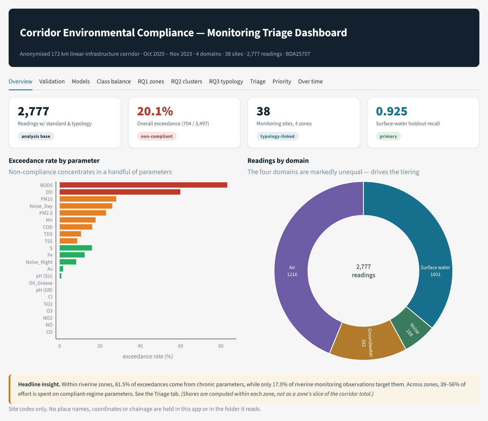
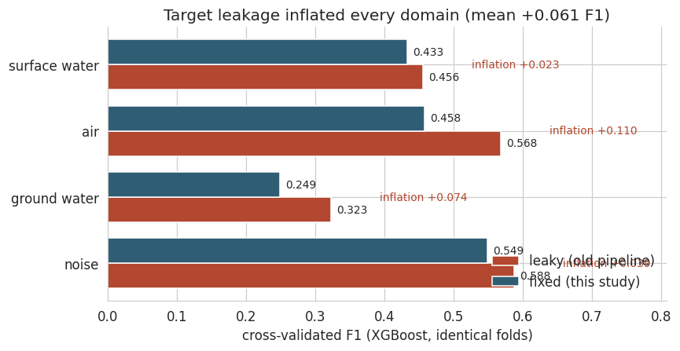
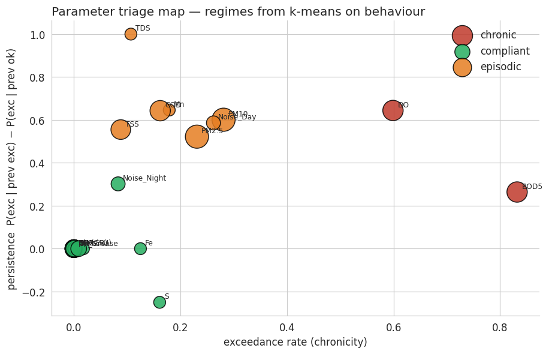
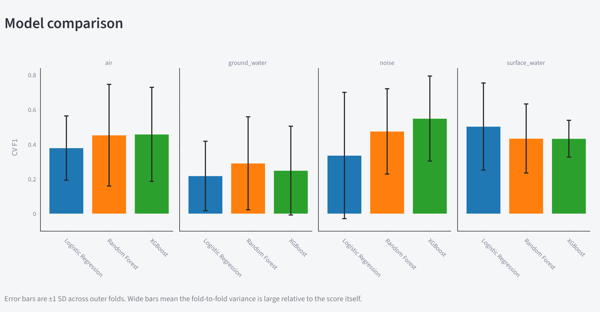
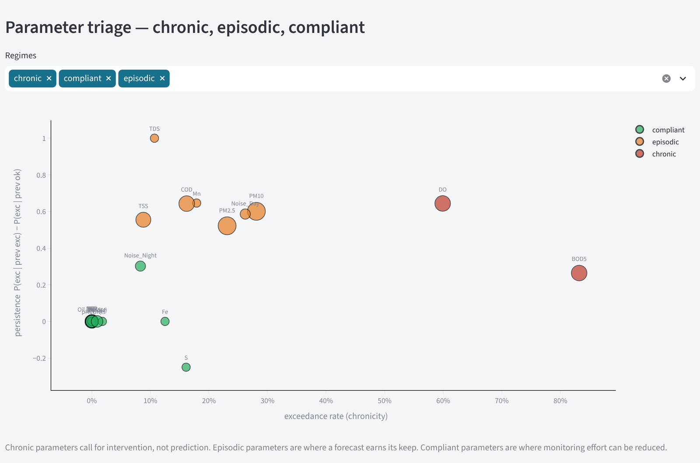
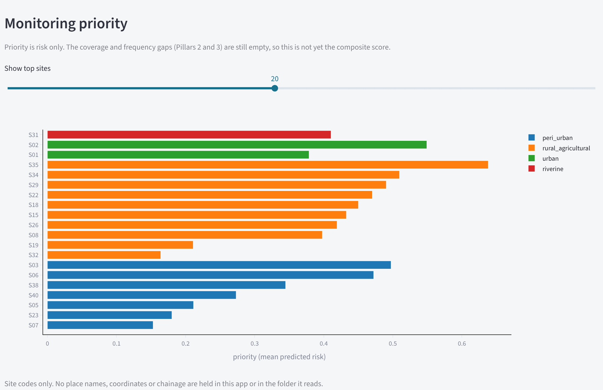
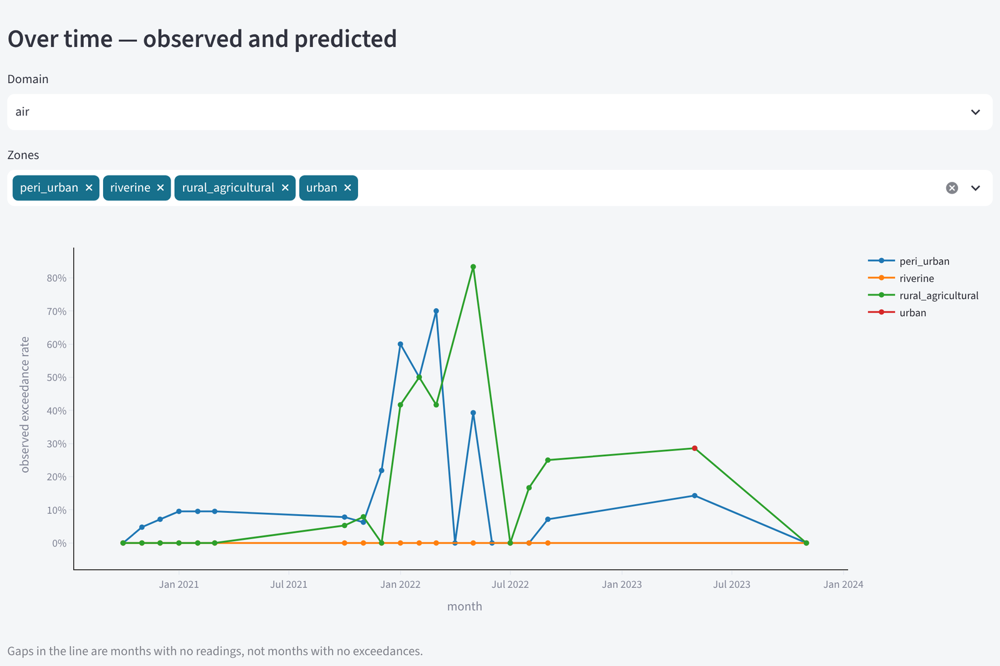

# Corridor Environmental Compliance

**Predicting environmental-standard exceedances before sampling, to prioritise monitoring along an infrastructure corridor**

MSc Business & Data Analytics dissertation · Ravensbourne University London · 2026




## Overview

Environmental monitoring during construction samples air, water and noise against national standards. This project asks whether an exceedance can be predicted **before the sample is taken**, so that monitoring effort can go where it is most needed.

The data cover October 2020 to November 2023 on an anonymised 172 km linear-infrastructure corridor in South Asia: four domains (air, surface water, groundwater and noise), 38 monitoring sites and 2,777 site-linked readings with a regulatory standard. The analysis follows CRISP-DM, from data preparation through to a dashboard.

## Key findings

- **A target-leakage bug had inflated earlier results.** A rolling-average feature included the current month's reading, which defines the target. Rebuilding it from past readings only lowered cross-validated F1 in every domain, by 0.023 to 0.110 (mean 0.061).
- **Honest baselines.** Knowing only which parameter is measured already gives F1 0.224–0.355. The full model beats that in every domain (noise: 0.549 vs 0.255), but for air a model without past readings scores higher still (0.534 vs 0.458).
- **Prediction is useful but uneven.** Best cross-validated F1 per domain: noise 0.549 (XGBoost), surface water 0.503 (logistic regression), air 0.458 (XGBoost) and groundwater 0.291 (random forest). Noise and groundwater have no readings after the cut-off, so their results are preliminary. On the time-based holdout, surface water reached F1 0.671 (recall 0.925) while air fell to 0.225, so a single holdout window is not treated as a verdict.
- **Site typology adds little.** Zone type, elevation and hydrology on their own changed recall by −0.032 compared with no spatial information, and by +0.014 on top of position along the corridor. The same design detects a planted zone effect (+0.088 recall) on synthetic data, so this is an informative null result.
- **Exceedance behaviour groups parameters, not places.** Clustering sites by exceedance behaviour does not recover their zone types (ARI 0.026). Parameters, however, fall into three clear regimes by exceedance rate and persistence (silhouette 0.715): chronic (BOD5, DO), episodic (PM10, PM2.5, Noise_Day, COD, Mn, TSS, TDS) and compliant (the other 13).
- **Monitoring effort and exceedance burden are misaligned.** In every zone, 39–56% of readings are of compliant-regime parameters, while chronic parameters account for 71–82% of exceedances in rural-agricultural and riverine zones.

<p align="center">
  
  
</p>

## Dashboard

An interactive Streamlit dashboard presents the results in ten tabs: overview, validation, models, class balance, the three research questions, parameter triage, site priority and trends over time. It reads only the anonymised files in [`dashboard/data/`](dashboard/data/).

<table>
  <tr>
    <td width="50%"><br><sub>Model comparison: cross-validated F1 per domain</sub></td>
    <td width="50%"><br><sub>Parameter triage: chronic, episodic and compliant regimes</sub></td>
  </tr>
  <tr>
    <td width="50%"><br><sub>Monitoring priority by site (anonymised codes)</sub></td>
    <td width="50%"><br><sub>Observed exceedance over time, by zone</sub></td>
  </tr>
</table>

To run it locally from the repository root:

```bash
pip install -r dashboard/requirements.txt
streamlit run dashboard/app.py
```

## Approach

| Step | What was done |
|---|---|
| Data preparation | Monthly and summary monitoring reports combined: 9,087 raw rows, 4,406 after cleaning and de-duplication. Monthly records take priority where both exist, and a stable sort makes the result reproducible. |
| Target | Exceedance of the national standard in force on the reading date; limits for NO₂, SO₂ and O₃ were tightened from June 2023. 3,497 readings have a standard, and 20.1% of them exceed it. |
| Features | Only information available before sampling: the parameter and its limit, position along the corridor, month and monsoon season, the previous reading and the mean of the three before it. |
| Models | Logistic regression, random forest and XGBoost with class weighting, compared within each domain. |
| Evaluation | Nested time-series cross-validation (5 outer folds, 3 for noise; inner folds tune the decision threshold) plus a time-based holdout from July 2022. |
| Checks | Leakage audit, baselines, SMOTE inside training folds only, a four-configuration spatial ablation with a synthetic positive control, and SHAP or model coefficients for interpretation. |

## Repository structure

```
notebooks/corridor_compliance_analysis.ipynb   full analysis with outputs (§0–§16)
dashboard/app.py                               Streamlit dashboard
dashboard/data/                                anonymised results exported by the notebook
dashboard/requirements.txt                     Python packages for the dashboard
figures/                                       charts exported from the notebook
assets/dashboard/                              dashboard screenshots
.streamlit/config.toml                         dashboard colour theme
requirements.txt                               Python packages for the notebook
```

## Data and privacy

The raw monitoring records come from an operational infrastructure project and are not published. Sites are identified only by anonymised codes (S01, S02, …): no place names, coordinates or chainage leave the notebook, and §15 checks every exported file for traceable columns. The notebook is published with its original outputs, so every result can be read without the raw data.

## Running the notebook

The notebook was developed on Google Colab. With the raw input files in a Google Drive folder, set `IN_DIR` in §0 and choose **Runtime → Run all**. To run it elsewhere, install the packages with `pip install -r requirements.txt` and replace the Drive mount with a local folder path.

## Author

**Simanta Karmaker** · MSc Business & Data Analytics (Distinction), Ravensbourne University London

Supervised by Farzana Sharmin Mou.

See also: [amazon-review-sentiment](https://github.com/simanta-karmaker/amazon-review-sentiment), a Bidirectional LSTM for classifying product reviews, built for the MSc AI & Machine Learning module.

## Licence

The code is released under the [MIT Licence](LICENSE). The anonymised result files and figures document the dissertation's findings; the underlying monitoring data are not included.
